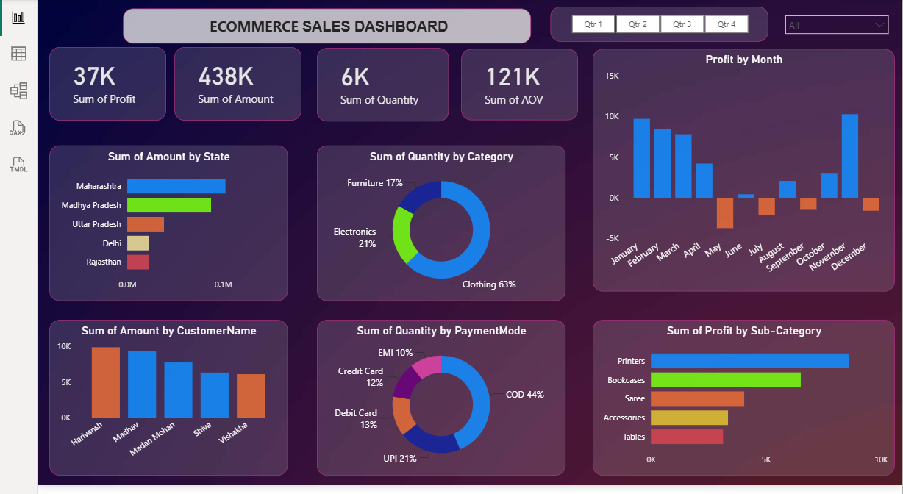

# E-Commerce Sales Analysis Dashboard

## 📊 Project Overview
An interactive Power BI dashboard built to analyze e-commerce sales performance and identify key business insights.

## 🛠️ Tools & Technologies
- Power BI
- Power Query
- DAX
- Excel

## 📈 Dashboard Features
- Total Sales
- Total Profit
- Total Quantity
- Average Order Value
- Sales by State
- Sales by Category
- Sales by Payment Mode
- Monthly Profit Analysis
- Top Performing Sub-Categories

## 🔍 Key Analysis
The dashboard helps analyze sales performance, profitability, customer purchasing patterns, product categories, and payment methods.

## 📷 Dashboard Preview

